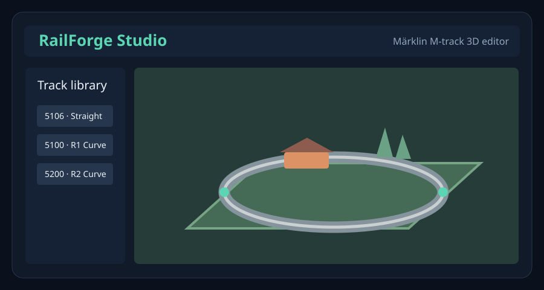

# RailForge Studio

A lightweight, open-source, browser-based 3D model railway layout editor focused on **Märklin H0 M-track**. Designed for rapid low-poly prototyping of tabletop railway layouts, multiple levels, terrain, and Blender presentations.



## Version 2.1 — smoother blank board

The editor now opens with an **empty** 2200 × 1100 mm board (no tracks, scenery or hills). Choose **Demo** to load the sample railway. Flat terrain renders as one quad (two triangles) rather than 2,800 overlapping triangles; sculpted terrain uses a reduced display mesh while preserving its original editable height data. The terrain is also separated from the plywood top to avoid z-fighting/flickering artifacts. Existing JSON project files remain compatible.

## Features

- 3D tabletop model editor with adjustable baseboard dimensions in millimetres
- Catalog of commonly used Märklin M-track pieces (straight rails, curves and turnouts)
- V2: frame-synchronised green connectors, bearing indicators and live placement previews
- V2: true-dimension 2D SVG track illustrations, catalog measurements and selected-piece diagrams
- V2: **Bridge a gap** assistant searches for exact 1–3-piece standard-track connections without stretching anything
- V2: improved snapping target area, accidental duplicate-placement protection, direct endpoint-height sliders
- Per-section heights, grades and elevated layouts
- Low-poly terrain sculpting, simplified scenery and tunnel placeholders
- X-ray view, camera presets and a simple train preview
- Project save/load to JSON, OBJ export and Blender Python-script export
- No account, installation, framework or build tools required; `index.html` and `v2.js` work together

## Run locally

Download **both** `index.html` and `v2.js` into the same folder and open `index.html` in Chrome or Edge. Alternatively, serve the folder locally with:

```bash
python -m http.server 8000
```

Then visit `http://localhost:8000/`.

## How to use

1. Set the tabletop size in the lower-left corner (dimensions are in **millimetres**).
2. Choose a track section in the left sidebar. Click the tabletop to place it, then click a green endpoint to snap another section on.
3. To close a gap, select **Bridge a gap**, click the two free endpoints, and choose a suggested exact-fit sequence. The assistant searches up to three common straight/curve sections. If no exact match exists, no track is placed.
4. For an elevated track, set a construction height before placing it, or select an existing section and change its start/end heights with the quick sliders or numeric inputs.
5. Switch to **Terrain** for simple hills or **Scenery** to add placeholder structures.
6. Toggle **X-ray** to inspect hidden trackwork.
7. Use **Save** to download an editable JSON project. Use **OBJ** or **Export to Blender** to create files for presentation and animation in Blender.

## Importing into Blender

- For the OBJ export, use **File → Import → Wavefront (.obj)** in Blender.
- For the Python exporter, switch to Blender's **Scripting** workspace, open the generated script and run it. Review scripts from any source before running them in Blender.

## Important limitations

RailForge V2 is a visual **prototype and planning aid**, not certified track CAD or a guarantee of physical fit. The gap solver only searches up to three common standard sections, and its geometric match is not a collision or clearance guarantee. The catalog includes commonly used parts, but is not exhaustive. Check real-world measurements, joints, turnout clearances, train clearances, curve compatibility, gradient transitions, reachable track sections, bridge structure, and electrical sections before buying or building. Tunnel markers and landscape models are schematic.

Project data is saved to downloaded files; it is **not synchronized to an online account**. GitHub Pages only hosts the app, not saved layouts.

## Publish with GitHub Pages

1. Create a **public** GitHub repository (for example, `railforge-studio`).
2. Upload this folder's files to the repository's default branch, keeping `index.html` at the repository root.
3. Under **Settings → Pages**, choose **Deploy from a branch**, select the default branch (typically `main`), folder **`/(root)`**, then Save.
4. The site should be accessible at `https://YOUR-USERNAME.github.io/railforge-studio/` once GitHub Pages finishes publishing.

## Contributing

Suggestions and contributions are welcome. Please open an issue describing a bug or feature request. When adding catalog entries, cite a trustworthy measurement source or provide measurements taken from a physical piece.

## License and trademark

Licensed under the [MIT License](LICENSE).

**Märklin** is a trademark of its respective owner. RailForge Studio is an independent community project and is not affiliated with or endorsed by Märklin.
## Version 2 notes

- Same JSON project format and Blender/OBJ exports as V1.
- The fixed-size track drawings use a common thumbnail scale; the selected-part inspector zooms to the full shape.
- The 3D renderer draws both sides of thin track sheets. Connector directions and green endpoints are updated with the camera rather than being regenerated on a slow timer.
- Known limitations: not every historical special track section is modeled; hidden-track and electrical clearances require manual checking, and the closure solver is not a universal layout optimizer.
